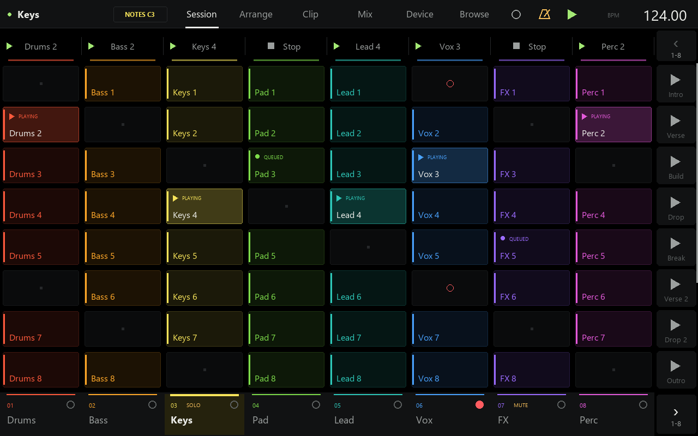
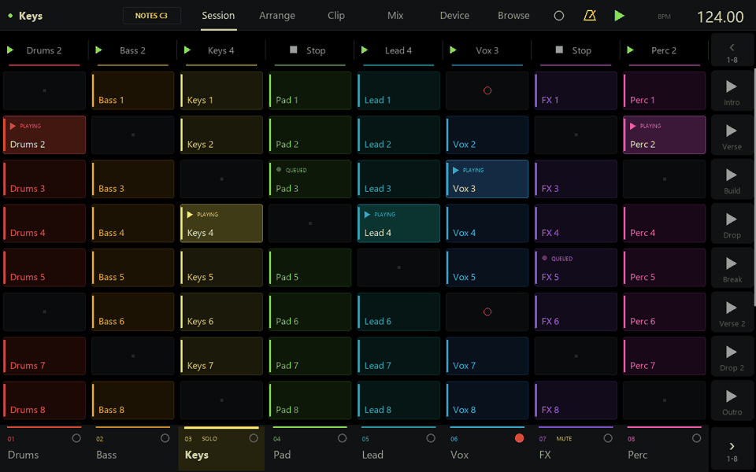

# MPC One Push

An independent, experimental Ableton Live controller that runs on the **MPC One's own touchscreen**.
Push-inspired screens, playable pads, Q-Links, clip editing and sound design over USB controller mode.



**Status: public preview.** A complete beat has been made with it on the tested hardware. Broader
hardware compatibility, full Save/Open/Export flows, real reconnect and USB animation timing still need
more field testing. This is a Windows host application, not standalone MPC firmware.

## What works

- Session clips/scenes, track management, fixed-length recording, playable pads, scales, chords, velocity curves, pressure routing and Note Repeat.
- Arrangement MIDI-note and WAV/AIFF waveform previews, touch selection, drag moves, and animated clip action menus.
- Piano roll, clip automation, audio/MIDI clip details and note tools.
- Mixer with meters, sends, returns, main volume and input/output routing.
- Device chains, racks, 66 stock device parameter layouts, EQ/filter/synth/effect visualizations,
  Simpler waveform/slicing and 16-knob plug-in pages.
- Browser search, Places samples, preview, device presets and touchable mirrored plug-in/Live dialogs.
- Push Studio UI with selection, touch and view-change animations.



## Requirements

Tested with Windows 10, original Akai MPC One firmware **2.10.0.82**, MPC One driver **1.0.5**,
MPC desktop **3.9.1**, Ableton Live **12**, and Python **3.14**. Other hardware and host configurations
are unverified. MPC One+ / Live / Live II / X are untested.

Install the official Akai MPC desktop software/driver first, and verify controller mode works there.
Keep the tested firmware when evaluating this project. The app streams display/control messages through
the installed drivers; it does not flash firmware or write to MPC storage.

## Other MPC models

If it doesn’t work with your specific MPC, a coding agent such as GPT/Codex or Claude may be able to
help adapt it. Give the agent this repository, your MPC model and firmware version, and a description
of what happens. Different models may need changes to USB identifiers, screen dimensions, button/pad
mappings or the controller protocol. Ask it to inspect and test those differences before connecting;
keep changes on the computer side, with no firmware flashing or writes to MPC storage. Compatibility
with other models is not guaranteed. Share successful adaptations through an issue or pull request.

## Setup

1. Install Python 3 with the Python launcher enabled, then clone/download this repository.
   **start-push.bat** creates its Python environment and installs Pillow on first launch (internet required).
   If you prefer manual setup, run these commands in the repository directory:

   ```powershell
   py -3 -m venv .venv
   .\.venv\Scripts\python.exe -m pip install -r requirements.txt
   ```

2. With Live closed, copy the bundled `addon/AbletonOSC` folder into your Live User Library's
   `Remote Scripts` folder. The default Windows location is
   `%USERPROFILE%\Documents\Ableton\User Library\Remote Scripts\AbletonOSC`.
   If AbletonOSC is already installed, back it up before replacing it. This bundled version includes
   project-specific extensions and the handler registration they require.
3. Open Live → Settings → Link, Tempo & MIDI. Select **AbletonOSC** in a Control Surface slot;
   set its Input and Output to **None**. This project uses OSC UDP ports 11000/11001.
4. For playable notes, install [loopMIDI](https://www.tobias-erichsen.de/software/loopmidi.html),
   create a port named **MPC One Push**, and enable **Track** for that input in Live's MIDI settings.
5. Close MPC desktop, connect the MPC over USB and enter controller mode. Close any other MPC controller
   app or tablet bridge. Launch **start-push.bat**. Quit using **SHIFT + MENU** or Ctrl+C.

The MPC app and tablet bridge share the reply port; run only one at a time. Avoid other control-surface
assignments competing for the MPC's ports. Change Live settings through its Settings UI.

## Try the interface without hardware

Run `.\.venv\Scripts\python.exe bridge/mpc_push_studio.py --desktop` for the offline desktop preview. Keys 1–6 switch pages;
A switches notes/automation; H shows help; Escape closes. This is a visual preview with a subset of
simulated interactions. `--demo` writes screenshots and an animated gallery under `design/push-studio/preview`.

`start-push.bat --reduced-motion` disables the added motion effects.
The public package has one launcher: **start-push.bat**, which opens the current Studio interface.

## Controls

| MPC control | Action |
|---|---|
| MAIN / NEXT SEQ / STEP SEQ | Session / Arrangement / Clip |
| TRACK MIX / PROGRAM EDIT / BROWSE | Mixer / Device / Browser |
| Pads | Play notes; TRACK MUTE toggles clip launch mode; Clip page uses step sequencing |
| Cue / Crossfader | MENU: adjust cue level and crossfader in 5% steps; center reset for the crossfader |
| Device management | Select a device, then MENU > Move selected device: move left/right within its chain or duplicate (when Live supports duplication in that chain) |
| Count-in | MENU: cycle Live’s native recording count-in through off / 1 / 2 / 4 bars |
| Rack macros | Select a rack on Device, then MENU > Rack macro variations: randomize, store, recall previous/next |
| Playing options | MENU: Chord (off/major/minor/sevenths/sus/octaves), Velocity (linear/soft/hard), Pressure (poly/channel/mod wheel/off). Chords bypass Drum Rack and 16 Levels |
| Arrangement clips | Tap to select and set playback start; drag the selected clip to empty space (beat snap, SHIFT for the Clip grid). Hold a clip or SHIFT+tap for Copy/Cut/Paste, Duplicate, Move to playhead, Activate/Deactivate, Loop, Rename, Colour, Undo/Redo and Delete. Hold empty lane space to Paste here |
| Q-Links | Four current mixer/device parameters; Q-LINK cycles the assigned group |
| Parameter automation | Hold a parameter, volume, pan or send, then Show automation. For device Q-Links: touch the knob and press MENU. Session uses clip envelopes; Arrangement opens a native Live editor preview with Draw/Edit, Undo/Redo and zoom (verification pending) |
| Arrangement recording | Pads play notes; entering Arrangement or starting Play/Record restores timeline playback and disables Session recording |
| Arrangement + TRACK | Upper-left button opens MIDI, audio and return track creation |
| Arrangement multi-select | Drag from empty lane space or an unselected clip to draw a selection box. Lift for Copy selection / Duplicate after. Hold empty space to Paste here; the top selected track anchors the pasted group. Drag the ruler to scroll |
| Data wheel | Navigate tracks/scenes/browser; SHIFT adjusts tempo |
| PAD BANK A–D | Note ranges or clip quadrants, depending on pad mode |
| PLAY / STOP / REC | Transport and recording; SHIFT+REC arms the selected track |
| Hold a track, clip or scene | Action sheet: rename, duplicate, color and other operations |
| MENU | Save, Open, Export, track/scene creation, playing options, help and quit |
| SHIFT+MENU | Quit |

Settings are created locally in `settings.json`. Logs and snapshots stay under `logs/` and are ignored
by Git. Places browsing reads Live's folder configuration. Plug-in/dialog touch and Save/Open/Export
use the Windows pointer/keyboard and can bring Live to the foreground; keep those windows unobstructed.

## Known limits

Multi-clip copy/paste and Duplicate After support up to 128 clips, preserving track offsets and timing gaps.
All destinations are checked before any copies are made. Group edits have one Undo step.
Arrangement automation lanes cannot be read/written through Live's Remote Script API. An experimental Windows accessibility/native-window fallback is implemented for Arrangement, tempo, return and Main mixer automation; end-to-end verification is pending. It needs Live in the foreground with English accessibility labels, and matching controls exposed by Live. Missing/ambiguous controls or unavailable captures disable touches and display an error. Draw mode paints; Edit mode manipulates native points. Native view uses the Windows pointer like the existing plug-in mirror. Only parameters exposed to the controller can be selected.
Arrangement resizing, splitting, time-range editing, and overlapping moves are not implemented.
Moves and pastes require empty space, including no overlap with the source clip. Cut is deferred until
paste succeeds. The arrangement clipboard references the copied clip and resets on add-on reload;
if its name, position or length changes, copy it again. MIDI previews show up to 512 source notes,
and detail requests cover up to 32 visible clips per lane. Audio previews support local WAV/AIFF files;
other formats show a preview-unavailable label. Thumbnail updates can take about two seconds.
Arrangement actions and audio/MIDI preview data were tested in Live on disposable tracks.
Physical touchscreen/pad testing remains pending. Large plug-ins may expose no parameters until configured in Live. Some plug-ins only expose
a Default program. Places preview supports WAV/AIFF, and the API limits some preset and sample workflows.
Note Repeat has offline timing coverage but needs more hardware testing. Musical work should be saved
regularly through Live. No zero-risk hardware compatibility claim is made.

## Development

```powershell
.\.venv\Scripts\python.exe tools/check_push_studio.py
.\.venv\Scripts\python.exe tools/check_reliability.py
.\.venv\Scripts\python.exe tools/check_playing.py
.\.venv\Scripts\python.exe tools/check_arrangement.py
.\.venv\Scripts\python.exe tools/check_addon_actions.py
.\.venv\Scripts\python.exe tools/check_arrangement_ui.py
.\.venv\Scripts\python.exe tools/check_automation.py
.\.venv\Scripts\python.exe tools/check_native_automation.py
```

These checks use simulated state, never open the MPC, and never edit the user's Live set.
`bridge/mpc_push.py` owns controls, `live.py` the OSC client, `push_ui.py` the shared renderer and
`push_studio_ui.py` Studio visuals. `mpc_screen.py` and `mpc_control.py` implement the controller-mode
protocol. Screen output is BGR; saved previews are RGB. Preserve that distinction.

## Credits

Created by SonkenGCA with Claude and OpenAI Codex assistance. Built on the MIT-licensed
[AbletonOSC](https://github.com/ideoforms/AbletonOSC) by Daniel John Jones and contributors, with its
bundled pythonosc dependency and project-specific extensions. Upstream notices are retained.
This is an unofficial project, unaffiliated with Ableton or Akai. Product names identify compatibility.
No firmware, manufacturer artwork, plug-ins, samples, or user preferences are distributed.
